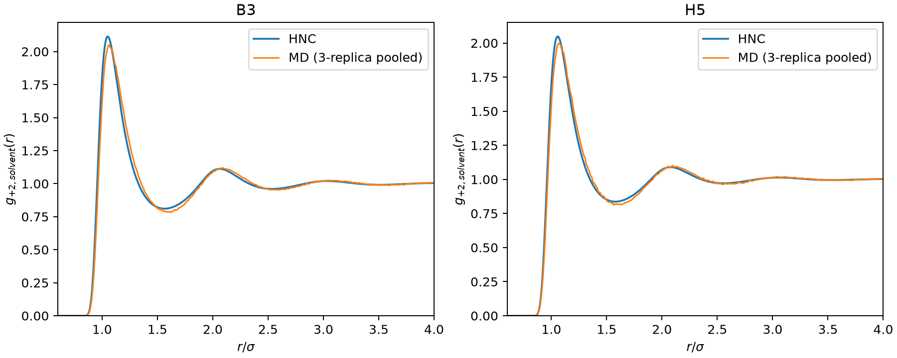

# MD pair-entropy study: results and interpretation

## Scope and estimator

The analysis covers all eight selected mixtures and three matched MD replicas per mixture (24 trajectories total). Each trajectory contains 4000 particles at \(T=2\), \(\rho=0.7\) and 2001 saved configurations spanning 1000 \(\tau\). Pair distributions were calculated directly from the saved positions. The primary RDF uses 1000 late frames per replica, finite-count ideal-gas normalization, physical merging of labels with identical charge and Lennard-Jones parameters, \(\Delta r=0.02\) and \(R=8.88\). A delete-block jackknife was used to remove finite-sample histogram bias. Since the initial core-bin check showed a measurable resolution effect, all records were also reprocessed to \(\Delta r=0.0025\) for \(r<3.2\); the reported resolved estimate uses \(\Delta r=0.005\) in that core and the measured \(\Delta r=0.01\) RDF outside it. The \(\Delta r=0.0025\) result is a resolution check.

The reported \(s_2\) is the pair contribution to the **excess configurational entropy**, in \(k_B\) per particle. It excludes ideal mixing entropy. The thermodynamic-integration (TI) result \(s_{ex}\) is the full excess entropy from the corresponding MD calculation. Thus \(s_{ex}-s_2\) is the contribution from correlations beyond pairs plus numerical/statistical differences between independent estimators; it is not an energy. Diffusion coefficients are self-diffusion values: \(D_{probe}\) averages the +2 and \(-2\) probes, and \(D_{net}\) is the composition-weighted mean over species, not a mutual-diffusion or conductivity coefficient.

The 95% intervals below use paired differences across the three common replica seeds and Student-\(t\) intervals with two degrees of freedom. They have no multiplicity correction. The intervals describe replica-to-replica variation; they do not include finite-size bias. Results for very small differences should therefore be read cautiously.

## Pair entropy compared with TI

| State | Components | TI \(s_{ex}\) | MD \(s_2\), resolved | \(s_{ex}-s_2\) | \(s_2/s_{ex}\) |
|---|---:|---:|---:|---:|---:|
| B3: baseline | 3 | −1.9710 | −1.6146 | −0.3565 | 81.9% |
| B5: monovalent salt | 5 | −1.9742 | −1.6177 | −0.3565 | 81.9% |
| U4: uniform weak solvent | 4 | −1.7721 | −1.4283 | −0.3438 | 80.6% |
| L5: equal-interaction label split | 5 | −1.7717 | −1.4283 | −0.3434 | 80.6% |
| M5: moderate dispersion split | 5 | −1.7417 | −1.4035 | −0.3382 | 80.6% |
| H5: strong dispersion split | 5 | −1.6689 | −1.3466 | −0.3223 | 80.7% |
| U6: monovalent, uniform weak solvent | 6 | −1.7760 | −1.4310 | −0.3450 | 80.6% |
| H7: monovalent, strong dispersion split | 7 | −1.6727 | −1.3490 | −0.3237 | 80.6% |

Pair entropy captures about 81% of the magnitude of TI excess entropy in these states. The remaining contribution is substantial, around −0.32 to −0.36 \(k_B\) per particle, and changes systematically across the dispersion series. Pair entropy therefore tracks most, but not all, of the entropy changes. It should not be substituted numerically for the full excess entropy without retaining this residual.

The primary estimator is robust to the core refinement: changing the fine-core width from 0.005 to 0.0025 changes \(s_2\) by \(0.00014\) to \(0.00019\,k_B\) per particle. By comparison, keeping the original \(\Delta r=0.02\) bins shifts the corrected means by about \(0.0028\) to \(0.0035\,k_B\) for the most relevant high-entropy systems. The independent ideal-point controls, processed through the same pipeline, give resolved \(s_2\) consistent with zero for all eight compositions. The result also passed 10-, 20- and 40-block jackknife checks, RDF cutoffs through \(R=8.88\), time-window checks, and finite-count versus bulk RDF normalization checks. The exact U4/L5 label-null histograms agree frame by frame for all three replicas.

## Does the extra component raise entropy and diffusion?

The cleanest numerical null is U4 versus L5. Splitting one neutral solvent into two labels with identical interactions changes neither the MD pair entropy nor any diffusion coefficient. The TI excess-entropy difference is \(+0.00042\;[-0.00219,\,0.00304]\), consistent with zero. Adding a species label and its ideal mixing contribution does not by itself change the excess entropy or dynamics.

The dispersion-split mixtures are different: they change physical interactions while adding a component. Relative to U4, M5 increases the full TI excess entropy by \(+0.0304\) and resolved \(s_2\) by \(+0.02485\;[0.02300,\,0.02669]\), about 82% of the TI change. H5 increases TI entropy by \(+0.10322\;[0.10209,\,0.10434]\), while \(s_2\) rises by \(+0.08170\;[0.08077,\,0.08262]\), about 79% of the TI change. The difference in the beyond-pair remainder is \(+0.02152\;[0.02057,\,0.02247]\). The analogous U6-to-H7 changes are \(+0.10331\) in TI and \(+0.08202\;[0.08154,\,0.08250]\) in \(s_2\), again about 79%.

For H5 relative to U4, the composition-weighted \(D_{net}\) rises by about 9.5% (paired log-ratio 95% interval about 9.0–10.0%). The mean probe diffusivity rises by 4.8% (about 0.6–9.2%). Considering the probe species separately, +2 rises by 3.6% (0.3–6.9%) and −2 rises by 6.1% (0.9–11.6%). For H7 relative to U6, \(D_{net}\) rises by about 8.4% (7.3–9.5%), but the mean probe change of 5.2% is unresolved (about −6.1–17.9%); separate +2 and −2 probe intervals are also broad and include zero. These diffusion intervals are based on only three replicas, so the H5 probe increases are suggestive rather than a final precision estimate.

Across the wider endpoint comparisons, H5 versus B3 and H7 versus B5 show larger probe diffusivity increases of about 20% and 18%, respectively. Those comparisons also change solvent interactions and, for the latter, salt content and ionic strength, so they do not isolate component number or entropy as the cause.

The tested states support a relationship between less negative excess entropy and larger self-diffusion, consistent with Rosenfeld-style scaling at this one density and temperature. Separate regressions for the +2 and −2 probe diffusivities against resolved \(s_2\) are also strong: for the four no-monovalent states, \(R^2=0.991\) and 0.995, with leave-one-state-out log-diffusivity RMSE 0.017 and 0.017; for the three monovalent states, \(R^2=0.992\) and 0.989, with RMSE 0.029 and 0.032. The fitted slopes remain positive when one replica is omitted. This supports a descriptive species-resolved correlation in these composition series, correcting the earlier impression that no such correlation exists. It is still based on only three or four state means per family, with diffusion uncertainties, and does not establish a universal Rosenfeld law. The matched H5/U4 comparison gives modest increases for both probes, while the H7/U6 comparison remains inconclusive for each probe. Thus the correlation is plausible across these mixtures, but the causal claim that adding a component and its entropy increase raises individual-ion diffusivity remains unproven.

The design does not isolate component count from interaction changes: the equal-interaction label split is an exact null, whereas M5/H5 and H7 alter the solvent dispersion parameters. The evidence supports the narrower statement that the dispersion changes raise both excess entropy and diffusion in the tested mixtures. It does not show that increasing the number of components alone causes either increase.

## HNC and RDF checks

Integrating each exported fine-grid HNC RDF reproduces the \(s_2\) stored by the HNC solver within \(5.4\times10^{-5}\,k_B\) per particle. This verifies the RDF column ordering, composition weights and pair factors used in the HNC comparison. It does not independently validate the HNC closure. HNC and MD \(s_2\) agree qualitatively and differ quantitatively: the resolved MD values are more negative by about 0.027 to 0.045 \(k_B\) per particle. The plotted probe(+2)-solvent RDFs show close agreement in the first coordination shells for B3 and H5, with small differences in peak height and the first minimum.

## Implication for a pair-entropy-only manuscript analysis

Using \(s_2\) alone would preserve the direction and most of the magnitude of the full TI entropy change in the controlled dispersion comparisons. It would not overturn the qualitative observation that the more weakly structured mixtures diffuse faster at the system level. It would understate the entropy increment by about 18–21% for the controlled changes and would leave a composition-dependent residual. The conclusion about the individual +2/−2 diffusivities would remain qualified: H5/U4 gives a modest increase with limited statistical support, and H7/U6 remains unresolved. Pair entropy thus provides a useful structural explanation and a practical proxy here, but it does not close the thermodynamic entropy budget or establish a species-specific Rosenfeld relation.

## Follow-up calculations

The most useful next step is to increase independent replicas or extend trajectories for U4/H5 and U6/H7, since the probe diffusivity contrasts set the main uncertainty. Then test whether the trend persists when varying ion fraction or ionic strength independently of solvent count and interaction parameters. A second set should vary solvent/ion size ratios while holding charge composition fixed; size asymmetry can change local packing and probe friction without relying on the same dispersion split. Finally, repeat selected points at a second density and temperature, and compare the full TI entropy, \(s_2\), species-resolved probe diffusion and reduced Rosenfeld diffusivity. This would distinguish a local pair-structure correlation from a more transferable scaling relation.

## Reproducibility files

- `summary.json`, `states.csv`, and `contrasts.csv`: complete numerical output and paired intervals.
- `entropy_benchmark.pdf`, `pair_entropy_diffusion.pdf`, and `convergence.pdf`: summary figures.
- `hnc_validation.json` and `hnc_md_probe_rdf.pdf`: HNC export consistency and representative RDF comparison.
- `../protocol.json` and the scripts in `../`: estimator and reproduction details.
- `validation.json`: independent histogram-kernel and formula checks.

The MD extraction array (Slurm job 101032, 24 tasks) and core-refinement array (job 101057, 24 tasks) completed with exit code 0. No new dynamics were needed; the analysis used the existing production trajectories.
